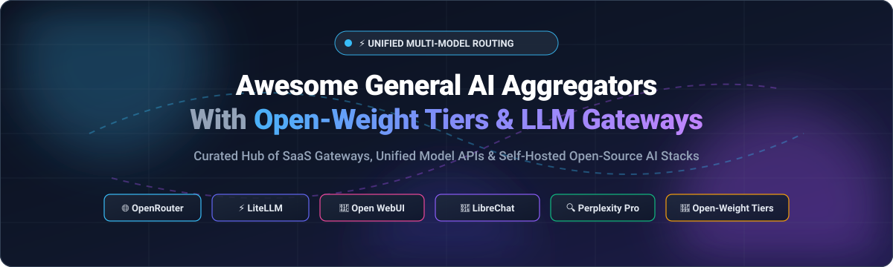

# 🌟 Awesome-General-AI-Aggregators-With-Open-Weight-Tiers

  

  
  
  
  
  
  
  

---

## 🎯 Top General AI Aggregators with Open-Weight Tiers Ecosystem

> 🚀 **Curated List of SaaS AI Platforms & Open-Source LLM Gateways**  
> *Focused on Multi-Model Access, Open-Weight Routing (Llama, DeepSeek, Qwen, Mistral) & Unified AI Interfaces*  
> 📅 **Last updated: October 2026**

This repository is an SEO-optimized, comprehensive directory tracking notable **SaaS platforms** and **open-source GitHub projects** for **General AI Aggregators with Open-Weight Tiers**. These tools provide a unified single interface or API gateway to frontier proprietary models (Claude 3.7/3.5, GPT-4o, Gemini 2.5 Flash/Pro) and open-weight models (Llama 3.3/3.1, DeepSeek V3/R1, Qwen 2.5, Mistral Large) with automatic failover, smart routing, fallback resilience, and cost optimization across providers.

---

## 📑 Table of Contents
- [📊 Sector Overview & Market Dynamics](#-sector-overview--market-dynamics)
- [☁️ SaaS / Hosted Platforms](#️-saas--hosted-platforms)
- [💻 Open-Source GitHub Projects](#-open-source-github-projects)
- [📈 Star History](#-star-history)
- [🤝 How to Contribute](#-how-to-contribute)
- [💖 Support](#-support)
- [⚖️ Disclaimer](#️-disclaimer)

---

## 📊 Sector Overview & Market Dynamics

The AI Gateway and multi-model aggregator sector is experiencing rapid expansion, sized at approximately **$2.76B to $3.7B in 2026** (up from ~$1.8B in 2025) and projected to surpass **$11B by 2032 at a CAGR of 27.5%**, while the broader multi-model integration and AI search market exceeds **$20B+**. The sector exhibits a **moderately fragmented and bifurcated market structure**: the enterprise gateway/routing infrastructure layer is consolidating rapidly toward standard proxy protocols (winner-take-most dynamics led by OpenRouter and LiteLLM alongside acquisitions by cybersecurity and cloud giants), whereas the user-facing chat aggregator and AI search space remains diversified among privacy-focused tools, developer search engines, and self-hosted open-source interfaces.

---

## ☁️ SaaS / Hosted Platforms

Below is the structured overview of commercial and hosted AI aggregators, sorted descending by company scale (valuation / annual revenue).

| Platform | Valuation / Revenue Scale | Starting Tier Price | Free Tier / Trial Limits | Key Highlights & Open-Weight Support |
| :--- | :--- | :--- | :--- | :--- |
| **[Perplexity Pro](https://www.perplexity.ai/pro)** | 🦄 **$20B–$22.6B Valuation** (~$750M ARR) | **$20.00 / month** (or $200/yr) | **Free forever plan**: Unlimited standard Quick Searches; ~5 Pro searches every 4 hours using standard models. | Leading AI search engine with model selector (GPT-4o, Claude 3.5, Sonar). Supports open-weight models including Llama 3.1 405B and DeepSeek. |
| **[Vercel AI Playground](https://sdk.vercel.ai/playground)** | 🦄 **$9.3B Valuation** (~$200M+ ARR) | **$20.00 / month** (Pro plan starting tier) | **Free forever plan**: Free Hobby account with side-by-side model comparisons, community rate-limited credits, and 14-day Pro trial. | Real-time multi-model comparison interface and streaming testing ground across OpenAI, Anthropic, Google, and open-weight Hugging Face/Fireworks models. |
| **[OpenRouter](https://openrouter.ai/)** | 🦄 **$1.3B Valuation** (~$150M ARR) | **Pay-as-you-go** ($5.00 min deposit; ~5% platform fee, pass-through token pricing) | **Free forever plan**: 50 requests/day & 20 requests/minute on all `:free` models (scales to 1,000 requests/day with $10 lifetime credit purchase). | The de facto standard API gateway with 400+ models from 60+ providers. Zero-cost open-weight tiers for Llama, DeepSeek R1/V3, Qwen, and Mistral. |
| **[You.com Pro](https://you.com/)** | 🦄 **$1.5B Valuation** (~$45M ARR) | **$20.00 / month** (or $15/mo billed annually) | **Free forever plan**: Unlimited basic searches + 5 Smart/Research queries per day with free trial on sign-up. | AI assistant & web search aggregator with model switcher (Claude, GPT, Gemini, Llama 3.3). Features custom agents and live enterprise search API. |
| **[Poe (by Quora)](https://poe.com/)** | 🏢 **$500M Valuation** (~$150M Quora ARR) | **$19.99 / month** (or $199.99/year) | **Free forever plan**: 3,000 compute points daily (resets every 24h) granting access to basic bots and open-weight models. | Consumer-friendly multi-bot aggregator by Quora. Unifies Claude, ChatGPT, Gemini, and open models (Llama, Mistral) with custom bot builder. |
| **[DuckDuckGo AI Chat](https://duckduckgo.com/aichat)** | 🏢 **$250M–$750M Est. Valuation** (~$100M+ Revenue) | **$9.99 / month** (Duck.ai Plus bundle) | **Free forever plan**: Free anonymous access with daily rolling token caps (resets at 00:00 UTC); no account or credit card required. | Zero-logging, privacy-first interface routing to GPT-4o mini, Claude 3 Haiku, Llama 3.3 70B, and Mixtral. Anonymizes IP and prevents model training. |
| **[Phind Pro](https://www.phind.com/)** | 💼 **~$11M Funding Raised** (YC S22) | **$20.00 / month** (Pro tier) | **Free forever plan**: 10 free Phind Instant queries per day; 30-day free trial on promotional tiers. | Developer-centric search engine and code generator with multi-model switcher between custom Phind-70B, GPT-4, and open-weight weights. |
| **[TypingMind](https://www.typingmind.com/)** | 🚀 **Bootstrapped** (~$1.9M ARR) | **$39.00 one-time license** (Standard plan) | **Free forever plan**: Web client with essential chat features using user's BYOK keys; free web demo with limited daily prompts. | Premier Bring-Your-Own-Key (BYOK) interface. Connects to OpenAI, Anthropic, Google, Ollama, and OpenRouter with offline local encryption. |
| **[ChatHub](https://chathub.gg/)** | 🚀 **Bootstrapped** (Est. <$1M ARR) | **$15.00 / month** (or $35.00 lifetime license) | **Free forever plan**: 2-model side-by-side comparison with basic web browser extension capabilities. | All-in-one browser extension client allowing 2-to-6 simultaneous side-by-side model completions with BYOK API support. |
| **[NanoGPT](https://nano-gpt.com/)** | 🚀 **Bootstrapped** (Micro-SaaS) | **$0.01 pay-per-prompt** (Crypto/card micro-balance) | **Free forever plan**: Free trial credit balance upon registration; select free-tier open models with rate caps. | Privacy-first pay-as-you-go aggregator requiring no subscription. Micro-billing per token across 100+ open-source and proprietary models. |

---

## 💻 Open-Source GitHub Projects

The following table lists the top open-source AI aggregators, multi-provider gateways, and self-hosted chat interfaces, sorted descending by GitHub stargazers. Each badge links directly to the respective repository's stargazers page.

| Project & Repository | GitHub Stars | License | Description & Architecture |
| :--- | :--- | :--- | :--- |
| **[OpenCode](https://github.com/sst/opencode)** |  | MIT | Open-source multi-provider agentic coding harness and terminal AI aggregator for proprietary and local open weights. |
| **[Open WebUI](https://github.com/open-webui/open-webui)** |  | BSD-3-Clause | Extensible, feature-rich self-hosted AI interface. Full offline support with Ollama, OpenAI-compatible APIs, RAG, and multi-user RBAC. |
| **[LangChain](https://github.com/langchain-ai/langchain)** |  | MIT | Universal framework for building context-aware reasoning applications with unified multi-provider model routing. |
| **[LobeChat](https://github.com/lobehub/lobe-chat)** |  | MIT | Modern, visually polished open-source AI chat framework with multi-provider routing (OpenAI, Claude, Ollama, OpenRouter) and plugin ecosystem. |
| **[Cline](https://github.com/cline/cline)** |  | Apache-2.0 | Autonomous agentic coding assistant supporting custom API keys, OpenRouter, and open-weight models directly in VS Code. |
| **[AnythingLLM](https://github.com/Mintplex-Labs/anything-llm)** |  | MIT | Complete enterprise-ready AI chat, RAG, and document agent platform supporting multi-LLM providers with zero setup Docker/Desktop apps. |
| **[LiteLLM](https://github.com/BerriAI/litellm)** |  | MIT | Universal multi-provider proxy gateway. Unifies 100+ LLMs via OpenAI standard format with load balancing, fallback routing, and spend tracking. |
| **[LlamaIndex](https://github.com/run-llama/llama_index)** |  | MIT | Data framework for LLM-based applications, RAG pipelines, and multi-model query federation over custom data. |
| **[LibreChat](https://github.com/danny-avila/LibreChat)** |  | MIT | Production-grade open-source chat platform clone with multi-provider support, code interpreter, conversation branching, and artifacts. |
| **[One API](https://github.com/songquanpeng/one-api)** |  | MIT | All-in-one LLM API routing gateway and management system. Redistributes and manages API quotas across OpenAI, Azure, Claude, and local models. |
| **[Continue](https://github.com/continuedev/continue)** |  | Apache-2.0 | Leading open-source autopilot coding extension connecting any open-weight or proprietary model to VS Code and JetBrains IDEs. |
| **[Chatbot UI](https://github.com/mckaywrigley/chatbot-ui)** |  | MIT | Clean, minimalist web interface for multiple AI models with prompt management and customizable BYOK endpoints. |
| **[Vercel AI SDK](https://github.com/vercel/ai)** |  | Apache-2.0 | The TypeScript library standard for building AI web apps with streaming and unified multi-provider abstractions. |
| **[Portkey Gateway](https://github.com/Portkey-AI/gateway)** |  | Apache-2.0 | Ultra-fast AI gateway with 250+ model connectors, automated retries, conditional fallbacks, caching, and production guardrails. |
| **[BetterChatGPT](https://github.com/ztjhz/BetterChatGPT)** |  | MIT | Infinite-context client interface supporting OpenAI, Azure, and proxy gateways with local client-side storage. |
| **[Helicone](https://github.com/Helicone/helicone)** |  | Apache-2.0 | Open-source LLM observability, cost tracking, caching, and multi-provider proxy gateway for production applications. |
| **[RouteLLM](https://github.com/lm-sys/RouteLLM)** |  | Apache-2.0 | Model router from LMSYS that dynamically routes prompts to cheap/open models or frontier LLMs based on query complexity. |
| **[BionicGPT](https://github.com/bionic-gpt/bionic-gpt)** |  | Apache-2.0 | Enterprise on-premise generative AI portal enabling multi-model privacy routing behind corporate VPC firewalls. |

---

## 📈 Star History

---

## 🤝 How to Contribute

We actively welcome community contributions to keep this ecosystem directory comprehensive, accurate, and up-to-date! 🌟

1. **Fork the repository** to your GitHub profile.
2. **Add or update an entry** in `README.md` following the tabular format and sorting criteria.
3. **Include verified facts**: Specific starting tier pricing, explicit free tier limits, company metrics, and official links.
4. **Submit a Pull Request** with a descriptive title explaining your addition.

---

## 💖 Support

Thank you so much for exploring and supporting **Awesome-General-AI-Aggregators-With-Open-Weight-Tiers**! ❤️

If you find this repository valuable:
- ⭐ **Star this repository** to help others discover it.
- 🍴 **Fork it** and contribute new tools or updates.
- 📢 **Share it** on X / Twitter, LinkedIn, Reddit, or Discord.
- ☕ **Buy a coffee & sponsor**: Support ongoing open-source research and directory curation via the [GitHub Sponsor Dashboard](https://github.com/sponsors/ishandutta2007).

---

## ⚖️ Disclaimer

- This list is community-curated for informational, architectural, and educational purposes. Inclusion does not imply official commercial endorsement.
- Model licenses and terms vary across open-weight models (e.g., Llama 3 Community License, Apache 2.0 for Qwen, DeepSeek License). Always verify upstream compliance before enterprise deployment.
- Pricing, company valuations, and free tier limits are subject to change by respective upstream vendors.

---

  <b>Built for developers, researchers, and enterprises engineering open, multi-model AI architectures. 🚀</b>

